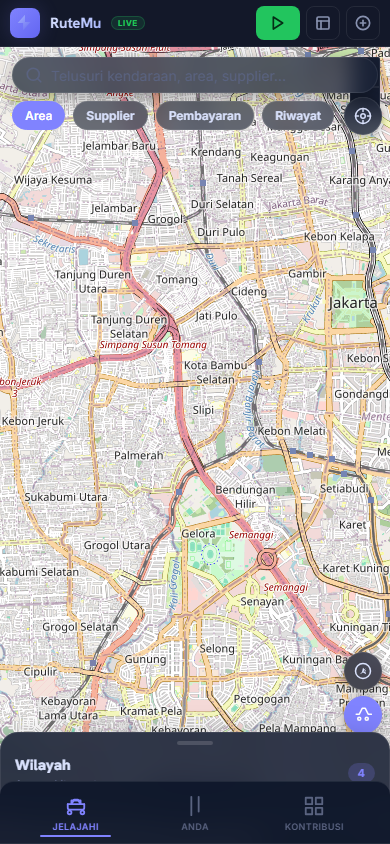

# RuteMu

Aplikasi web pemantauan rute dan pergerakan kendaraan secara *real-time* dengan peta interaktif.

<p align="left">
  
  
  
  
</p>

---

## Preview



---

## Fitur Utama

- Pemantauan lokasi dan rute kendaraan secara *real-time* di atas peta interaktif.
- Antarmuka responsif bertema gelap yang dioptimalkan untuk tampilan desktop dan mobile.
- Backend API & penyimpanan data rute menggunakan Express dan MongoDB.

---

## Menjalankan Secara Lokal

1. **Install dependencies**
   ```bash
   npm install
   ```

2. **Konfigurasi environment (`.env`)**
   ```env
   PORT=3000
   MONGO_URI=mongodb://localhost:27017
   MONGO_DB=rute_mu
   ```

3. **Jalankan server**
   ```bash
   npm start
   ```
   Aplikasi berjalan di `http://localhost:3000`.